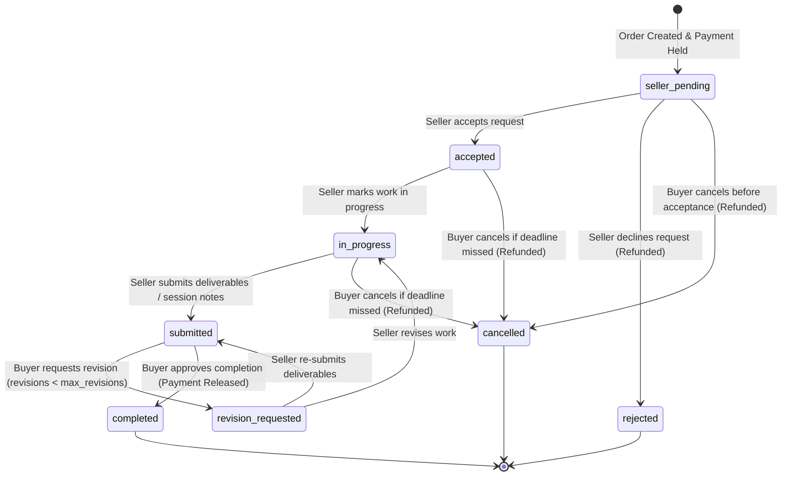

# SkillBridge Unified Booking, Orders & Service Delivery Architecture

## 1. System Overview

SkillBridge unifies consultation appointment scheduling and deliverable-based gigs into one coherent, database-backed transaction lifecycle. Previously, consultation bookings (`public.bookings`) existed in isolation without escrow linkage, order statuses, or delivery verification. Feature 07 consolidates all transactions under `public.orders`, supporting two explicit service types with dedicated workflows.

```
+---------------------------------------------------------------------------------------+
|                                    SERVICE TYPES                                      |
+-------------------------------------------+-------------------------------------------+
| 1. Fixed-Scope Gigs                       | 2. Scheduled Consultations                |
|    - Agreed deliverables & deadlines     |    - Date, start/end time, duration       |
|    - Delivery days turnaround             |    - Provider active availability slots   |
|    - Revision requests & file uploads     |    - Google Meet / Campus location        |
+-------------------------------------------+-------------------------------------------+
                                            |
                            POST /api/orders (Server Route)
                                            |
+-------------------------------------------v-------------------------------------------+
|                          DATABASE TRANSACTION & ENFORCEMENT                           |
|  - Anti-Self-Booking: CHECK (buyer_id <> seller_id)                                  |
|  - Concurrency Lock: FOR UPDATE on availability_slots & confirmed bookings            |
|  - Historical Snapshot: JSONB service_snapshot stored immutably with order            |
|  - Initial Status: 'seller_pending' with escrow hold recorded                         |
+---------------------------------------------------------------------------------------+
```

---

## 2. Order Lifecycle & State Machine



### State Machine Transition Rules

| Transition | Permitted Actor | Prerequisite Status | Resulting Status | Financial / Calendar Effect |
| :--- | :--- | :--- | :--- | :--- |
| **`accept`** | Seller / Admin | `seller_pending` | `accepted` | Delivery clock started; session locked. |
| **`reject`** | Seller / Admin | `seller_pending` | `rejected` | Escrow refunded; booking slot freed. |
| **`start_work`**| Seller / Admin | `accepted` | `in_progress` | Indicates active work or consultation prep. |
| **`submit_work`**| Seller / Admin| `in_progress`, `revision_requested`, `accepted` | `submitted` | Deliverable link and notes submitted. |
| **`request_revision`**| Buyer / Admin | `submitted` | `revision_requested` | Increments `revisions_count`. Permitted only if `revisions_count < max_revisions`. |
| **`complete`** | Buyer / Admin | `submitted` (Gig) or `accepted` (Consultation) | `completed` | Escrow payment released to seller; reviews unlocked. |
| **`cancel`** | Buyer | `seller_pending` OR `due_date < now()` | `cancelled` | Escrow refunded; booking slot freed. |
| **`cancel`** | Seller / Admin | Any active state | `cancelled` | Escrow refunded; booking slot freed. |

---

## 3. Concurrency, Security & Integrity Defenses

1. **Anti-Self-Booking Enforcement**:
   - Enforced by PostgreSQL CHECK constraint: `ALTER TABLE public.orders ADD CONSTRAINT orders_no_self_booking_check CHECK (buyer_id <> seller_id);`.
   - Also verified in server routes (`app/api/orders/route.ts`).
2. **Concurrent Double-Booking Prevention**:
   - The `create_unified_booking_order` RPC and `book_service` functions issue a `FOR UPDATE` row-lock query across `bookings` where `provider_id = p_provider_id AND booking_date = p_booking_date AND start_time = p_start_time AND status = 'confirmed'`.
   - Any simultaneous transaction attempting to book the same slot is safely serialized or rejected with a 409 Conflict exception.
3. **Participant Access Boundary**:
   - `app/api/orders/[id]/route.ts` and `app/api/orders/[id]/transition/route.ts` verify the caller's JWT token.
   - Any user who is neither buyer nor seller (and does not possess `is_admin = true`) receives an immediate `403 Forbidden` response.
   - The UI displays an Access Restricted screen rather than leaking order details, files, or messages.
4. **Historical Snapshot Preservation**:
   - Orders capture `service_snapshot` (title, description, agreed price, delivery days, location) upon creation. If the service listing is later edited, paused, or archived, existing order records remain immutable.
5. **Revision Bounds**:
   - Orders specify `max_revisions` (default 2). Once the revision limit is reached, the UI disables revision requests and requires completion approval or administrative dispute resolution.
6. **Financial Truthfulness**:
   - In accordance with platform governance, payments are tracked as simulated student escrow holds (`status = 'paid'`, `status = 'refunded'`). No false claims of third-party bank holding are made to students.
