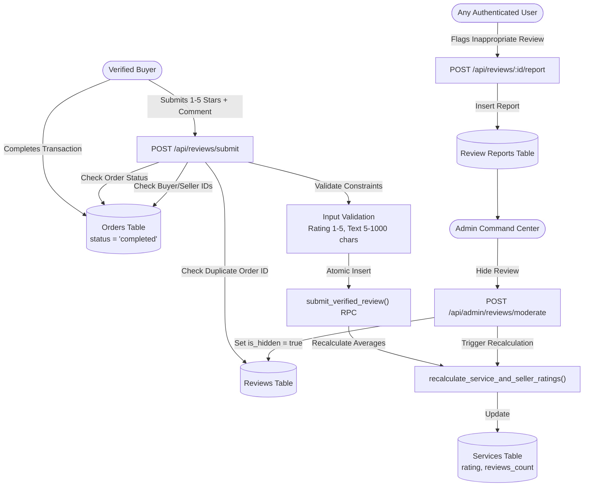

# Verified Reviews & Seller Reputation

## Executive Overview

SkillBridge implements an authentic, transaction-backed reputation and review system. Peer ratings in a college marketplace must be trustworthy and immune to fraud, sybil attacks, self-promotion, and fabricated reviews.

Key foundational tenets:
1. **Verified Transaction Requirement**: Reviews can **only** be submitted after an eligible order is genuinely `completed`. Uncompleted orders (`pending`, `accepted`, `in_progress`, `delivered`, `revision_requested`, `cancelled`) are strictly rejected.
2. **Strict Participant Binding & Anti-IDOR**: The reviewer **must** match `order.buyer_id`, and the reviewee **must** match `order.seller_id`. Arbitrary third parties cannot submit reviews on other users' transactions.
3. **Anti-Self-Review Defense**: Sellers are barred from reviewing their own services (`buyer_id === seller_id` or `reviewer_id === reviewee_id` rejected).
4. **Duplicate Prevention**: A unique database index on `order_id` ensures that each completed order can only be reviewed once. Subsequent submissions are blocked.
5. **No Hardcoded Ratings or Frontend Averages**: Ratings are never defaulted to `5.0`. Services with zero reviews report `0.0` or empty states. All scores and breakdown distributions are calculated authoritatively from active database records.
6. **Community Reporting & Administrative Governance**: Users can report inappropriate reviews. Platform administrators can hide, restore, or dismiss reports. Hiding a review immediately recalculates the service and seller aggregate ratings without manual scripts.

---

## 1. System Architecture



---

## 2. Server-Side Validation & Constraints

| Field | Type | Server Validation Rules | Error Response |
| :--- | :--- | :--- | :--- |
| `order_id` | UUID | Must exist in `orders`, status must be `completed`, `buyer_id` must match authenticated caller | `400 Bad Request` or `403 Forbidden` |
| `service_id` | UUID | Must match `order.service_id` | `400 Bad Request` |
| `reviewer_id` | UUID | Must equal `session.user.id` and `order.buyer_id` | `403 Forbidden` |
| `reviewee_id` | UUID | Must equal `order.seller_id` and must **not** equal `reviewer_id` | `400 Bad Request: Self-review violation` |
| `rating` | Integer | Must be an integer between 1 and 5 inclusive (floats and strings rejected) | `400 Bad Request: Rating must be an integer between 1 and 5 stars` |
| `comment` | String | Must be between 5 and 1,000 characters (trimmed) | `400 Bad Request: Review text must be between 5 and 1000 characters` |

---

## 3. Database Schema & Migration (`015_verified_reviews_and_reputation.sql`)

### 3.1 Reviews Table Extensions

```sql
ALTER TABLE public.reviews ADD COLUMN order_id uuid REFERENCES public.orders(id) ON DELETE CASCADE;
ALTER TABLE public.reviews ADD COLUMN is_hidden boolean NOT NULL DEFAULT false;
ALTER TABLE public.reviews ADD COLUMN moderation_status text NOT NULL DEFAULT 'published';
ALTER TABLE public.reviews ADD COLUMN report_count integer NOT NULL DEFAULT 0;

-- Unique constraint ensuring 1 review per completed order
CREATE UNIQUE INDEX idx_reviews_order_id_unique
  ON public.reviews(order_id)
  WHERE order_id IS NOT NULL;

-- Filtered indexes for fast active review retrieval
CREATE INDEX idx_reviews_service_visible
  ON public.reviews(service_id, is_hidden)
  WHERE is_hidden = false;

CREATE INDEX idx_reviews_reviewee_visible
  ON public.reviews(reviewee_id, is_hidden)
  WHERE is_hidden = false;
```

### 3.2 Review Reports Table

```sql
CREATE TABLE IF NOT EXISTS public.review_reports (
  id uuid PRIMARY KEY DEFAULT gen_random_uuid(),
  review_id uuid NOT NULL REFERENCES public.reviews(id) ON DELETE CASCADE,
  reporter_id uuid NOT NULL REFERENCES public.profiles(user_id) ON DELETE CASCADE,
  reason text NOT NULL,
  status text NOT NULL DEFAULT 'pending', -- 'pending' | 'resolved' | 'dismissed'
  resolved_by uuid REFERENCES public.profiles(user_id) ON DELETE SET NULL,
  resolved_at timestamptz,
  created_at timestamptz NOT NULL DEFAULT now(),
  CONSTRAINT unique_report_per_user_review UNIQUE (review_id, reporter_id)
);
```

### 3.3 Atomic RPCs

1. **`submit_verified_review`**:
   - Verifies caller matches buyer.
   - Verifies seller matches reviewee and is distinct.
   - Verifies order status is `completed`.
   - Inserts review record.
   - Immediately invokes `recalculate_service_and_seller_ratings`.
2. **`recalculate_service_and_seller_ratings`**:
   - Queries `reviews` where `is_hidden = false` and `moderation_status != 'hidden'`.
   - Updates `services.rating` to the exact rounded average (`ROUND(AVG(rating), 1)`).
   - Updates `services.reviews_count` to `COUNT(*)`.
3. **`moderate_review`**:
   - Allows platform administrators to set `is_hidden = true|false` and `moderation_status = 'hidden'|'published'`.
   - Updates associated `review_reports` to `resolved` or `dismissed`.
   - Invokes `recalculate_service_and_seller_ratings` to update public scores.

---

## 4. Rating Aggregations & Breakdowns

### 4.1 Authoritative Formula

```typescript
// Strictly exclude hidden and moderated reviews
const activeReviews = reviews.filter((r) => !r.is_hidden && r.moderation_status !== 'hidden');
const total = activeReviews.length;

if (total === 0) {
  return { average: 0, total: 0, distribution: { 1: 0, 2: 0, 3: 0, 4: 0, 5: 0 }, percentages: { ... } };
}

let sum = 0;
activeReviews.forEach((rev) => {
  const star = Math.max(1, Math.min(5, Math.round(rev.rating)));
  distribution[star] = (distribution[star] || 0) + 1;
  sum += rev.rating;
});

const average = Math.round((sum / total) * 10) / 10;
```

### 4.2 Impact of Moderation Actions

| Action | `is_hidden` | `moderation_status` | Effect on Average Score | Effect on Review Count |
| :--- | :--- | :--- | :--- | :--- |
| **Published** | `false` | `'published'` | Factored in weighted average | Incremented by 1 |
| **Hide Review** | `true` | `'hidden'` | **Instantly removed** from average calculation | Decremented by 1 |
| **Restore Review** | `false` | `'published'` | **Reinstated** into average calculation | Incremented by 1 |
| **Dismiss Report** | `false` | `'published'` | Unchanged (review remains visible) | Unchanged |

---

## 5. UI Components & Frontend Integration

1. **`RatingBreakdown` (`components/reviews/rating-breakdown.tsx`)**:
   - Displays the large score badge (e.g. `4.8 / 5.0`), five gold stars, total verified reviews count, and "Campus Verified Peer Score" trust badge.
   - Shows percentage bars for 5, 4, 3, 2, and 1 star ratings.
2. **`ReviewCard` (`components/reviews/review-card.tsx`)**:
   - Displays student reviewer avatar, full name, college tag, verified buyer badge, gold stars, review date, and review text.
   - Includes an inline "Report" button allowing community members to flag inappropriate content.
3. **`ReviewModal` (`components/reviews/review-modal.tsx`)**:
   - Interactive star rating picker (1 to 5).
   - Textarea with live character counter (5–1,000 characters).
   - Dispatches review submission to `POST /api/reviews/submit`.
4. **Service Detail Page (`app/(main)/services/[id]/page.tsx`)**:
   - Replaced static default 5.0 rating with real data from `fetchServiceReviews(serviceId)`.
   - Embeds `RatingBreakdown` and `ReviewCard` list.
5. **Seller Profile Page (`app/(main)/profile/[id]/page.tsx`)**:
   - Replaced mocked reviews with real aggregated reviews across all seller services using `fetchSellerReviews(sellerId)`.
6. **Platform Command Center (`app/(main)/admin/page.tsx`)**:
   - "Review Moderation" tab displaying all community reported reviews.
   - Includes actions: "Hide Review (Exclude from Ratings)", "Restore Review", and "Dismiss Report".

---

## 6. Automated Test Suite (`test:reviews`)

The test suite in [`scripts/test-verified-reviews-reputation.mjs`](file:///e:/MITWPU/Engineering/3rd%20Year/SEM/Project/project/scripts/test-verified-reviews-reputation.mjs) validates 62 test cases:

- **Suite 1**: Order Completion Eligibility (rejects `pending`, `accepted`, `in_progress`, `delivered`, `cancelled`).
- **Suite 2**: Participant Binding & IDOR Protection (rejects unauthorized third parties).
- **Suite 3**: Anti-Self-Review Defense (`buyer_id === seller_id` blocked).
- **Suite 4**: Duplicate Review Prevention per Order (second review rejected).
- **Suite 5**: Server-Side Input Validation (ratings 1–5, text 5–1000 chars).
- **Suite 6**: Authoritative Rating Aggregations (zero reviews yield 0.0, weighted distribution).
- **Suite 7**: Moderation Impact on Aggregate Ratings (hidden reviews excluded from score).
- **Suite 8**: Community Reporting & Duplicate Report Prevention.
- **Suite 9**: Administrative Moderation Lifecycle (`hide`, `restore`, `dismiss`).
- **Suite 10**: Review History Sorting (newest first).
- **Suite 11**: Migration 015 SQL Schema & RLS Policy Verification.
- **Suite 12**: Live Supabase Database Connectivity & Schema Check.
